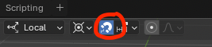

# Concepts

- The cursor () is used by most camera movements e.g. rotation

# Camera Movements

- Middle mouse button or 2 fingers + move: rotation
- Middle mouse button or 2 fingers + SHIFT + move: panning
- Middle mouse button or 2 fingers + CTRL + move: move along camera view direction
- Magnify or mouse scroll: zoom

# Basic Shortcuts

- TAB: switch between object and edit mode
- SHIFT + S: snap pop-up menu e.g. snap cursor to selection
- SHIFT + SPACE: actions related to the curren mode i.e. actions available on the left ribbon (e.g. cursor, move, scale, etc.)
- N: Show/Hide object properties pane

# Useful Tools

- Bevel: Round/cut edges
- Snapping: Very useful when moving vertices or objects around

